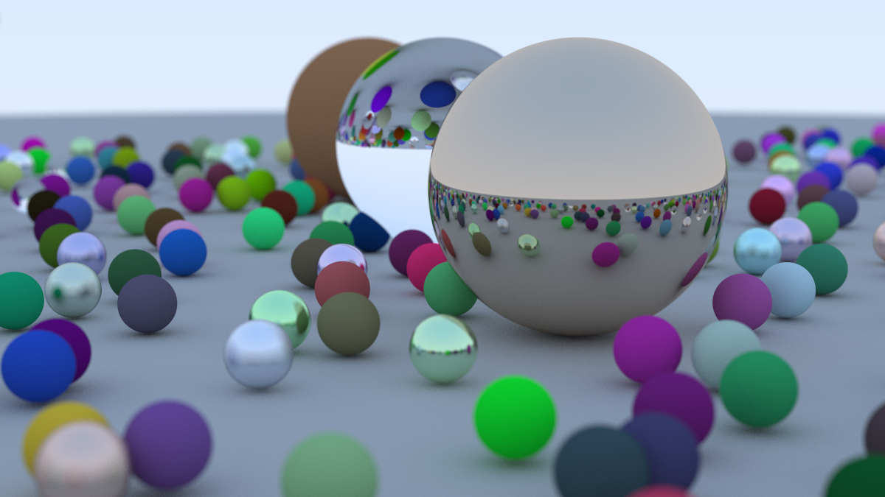
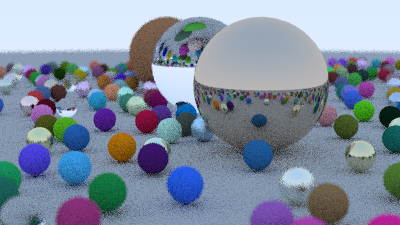

# Ray Tracing In One Weekend But Faster

A multithreaded implementation of Peter Shirley's 
[*Ray Tracing in One Weekend*](https://raytracing.github.io/books/RayTracingInOneWeekend.html)
cutting render time from **20 minutes to 6 minutes**.



*Using 1200x675 resolution with 500 samples per pixel*

## Performance

| Version        | Render Time | Speedup |
|----------------|-------------|---------|
| Single-threaded| 20 min      | 1.0x    |
| Multithreaded  | 6 min       | 3.3x    |

*No Optimization Compiler Flags* 



*Using 400x255 resolution with 10 samples per pixel*

### Render Settings

- Aspect Ratio: 16:9  
- Resolution: 1200x675  
- Samples Per Pixel: 500  
- Max Ray Depth: 50  

## Setup Used

- CPU: AMD Ryzen 5 5600X (12 Threads)
- GPU: NVIDIA GeForce RTX 3060 Ti  
- OS: Fedora Linux 44  
- Compiler: GCC 16.2.1  

## How It Works

### The Threads 

The bulk of where the multithreading can be found in camera.h. Utilizing the CPU, we can use all the threads in our CPU cores to parallelize the computation at each row. Splitting the image into rows and distributing them across N threads. Each thread writes to its own region in a .ppm file. 

### At Each Pixel

At a high level, the book starts off with a simple method of calculating the color for each pixel. Point sampling was utilized early in the book, but the problem with this is that it creates sharp edges of the shape that we want to draw. This is because point sampling is done by checking (casting a ray) at a single point---in this case the center of that pixel---and then colors the pixel accordinly. We can fix this by following a ray tracing technique called Stochastic Sampling. Instead of firing one ray through the center of the pixel, we fire multiple rays at randomized position within that single pixel. Thus fixing the sharp, jagged, edges. This is also called Anti-aliasing (AA).

### Handling Random Number Generation

The book utilizes ```std::rand``` which is considered a legacy feature, and it is used in the book. However, it is not thread-safe because it relies on a global static variable that is altered every time the function is called. This means that if we have multiple threads calling ```std::rand```, multiple threads could read and write to the global variable at the same time, causing a data race. Even if C++ handles it correctly without crashing, the issue then becomes that the sequence is no longer non-deterministic. Threads calling ```std::rand``` and performing some calculation would use the same random value, causing them to generate identical numbers. 

## Build and Run

```bash
  git clone https://github.com/saranillozed55/raytracer.git
  cd raytracer
  make run
```

## What I learned / Challenges

This project was my introduction to multithreading and ray tracing. Along the way I learned:

- **Parallelizing independent work:** Each pixel can be computed without
  depending on any other, which makes ray tracing a great fit for threads.
- **Race conditions:** When multiple threads touch shared data at the same
  time, results can become corrupted or unpredictable. I learned to spot these
  and structure the code so threads don't step on each other.
- **Other threading pitfalls:** Problems like shared state, thread-unsafe
  random number generation, and synchronization overhead showed me that more
  threads doesn't automatically mean a perfect speedup.
- **Dynamic task delegation:** Instead of giving each thread a fixed chunk of
  the image up front, I distributed work dynamically so threads that finish
  early can pick up more. This keeps all cores busy, since some parts of the
  image take much longer to render than others.

## Future Improvements

- Porting this to utilize the GPU instead of the CPU as the GPU is meant to handle parallel tasks in massive loads. Can be done in CUDA.
- BVH acceleration structure without moving to the GPU yet.
- Tile-based scheduling for better load balancing.

## Credits 

Based on *Ray Tracing in One Weekend* by Peter Shirley, Trevor David Black,
and Steve Hollasch.
